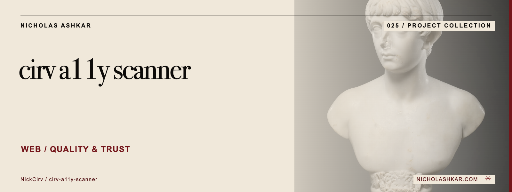

# cirv-a11y-scanner

Provides a Cirvgreen web interface and API for selected static HTML accessibility checks.


<a id="deploy"></a>

<a id="api"></a>

<a id="post-apiscan"></a>

<a id="get-healthz"></a>

<a id="wcag-checks"></a>

<a id="structure"></a>

## What it does

- POST /api/scan accepts a url.
- Checks alternative text, headings, selected color pairs, form labels and link text.
- GET /healthz supports health checks.

## Quickstart

Prerequisites: Node.js `>=20` and npm. The checkout below pins the source used for this documentation.

```sh
git clone https://github.com/NickCirv/cirv-a11y-scanner.git
cd cirv-a11y-scanner
git checkout e72e234bec16a74193aa507d1a43ad5295b9074e
npm install
npm start
```

**Expected behavior (illustrative, not captured):** Starts the local Express service on port 3000 by default; GET /healthz returns an object with ok set to true.

With the service running, a separate terminal can request its local health endpoint:

```sh
curl http://localhost:3000/healthz
```

The handler constructs `{"ok":true}`. To submit a scan, send JSON with a `url` field to `POST /api/scan`; that operation fetches the supplied site.

Examples are source-inspected, **not runtime-tested**. See the research record for verification gaps.


<a id="security"></a>

<a id="what-it-is-not"></a>

## Boundaries and data

Checks inspect fetched HTML, not a rendered browser session. Scores are screening signals, not WCAG or ADA certification. The scan endpoint fetches user-selected URLs through the repository's URL-safety checks.

## Development

The manifest defines `npm test` as:

```sh
node test.js
```

The captured tests cover selected implementation paths; their presence does not establish a passing run. Tests were not run for this documentation revision.

See [implementation and command reference](docs/REFERENCE.md) for the package scripts and inspected interfaces, and [research record](docs/RESEARCH.md) for the pinned source, document decisions and unresolved checks.

This is a Cirvgreen product surface; its product-specific brand authority is preserved.

## License and contact

See [LICENSE](LICENSE) for the original terms and attribution. Legal text is unchanged.

[Nicholas Ashkar](https://nicholashkar.com/) · [Discuss a project](https://nicholashkar.com/#oxblood-contact)
